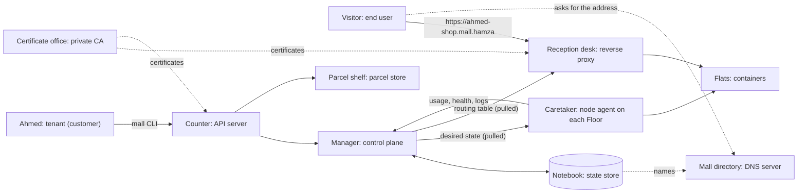

# Mini Cloud, Part 1: the platform

**Status:** draft for review. The design was approved in conversation on 2026-10-03.
**Pictures that go with this document:** `mini-cloud-design-v6.png` (the design) and `mini-cloud-complete-map.png` (everything a cloud has, 88 items).
**Reading tip:** every mall word has a technical twin in brackets. The technical words are the ones to learn.

---

## 1. Purpose

Build a tiny cloud provider from scratch, in Go. A customer hands in a small web app with one command. The platform runs it in an isolated container, gives it a name, keeps it alive, measures what it uses and produces a bill.

The picture to keep in mind is a **mall**. The customers are people who make apps. They rent locked **flats** (containers) on **Floors** (worker nodes). You build the building, the locks, the reception desk, the meter and the health board. You do not build the shops inside.

This is **part 1 of 4**. Later parts, only after part 1 works: (2) a security guard (SOC), (3) a file-storage service (object store), (4) a 5G telecom app that runs on the platform.

**What it is not:**
- It is not an online shop and not Shopify. Shopify sells ready-made shops. This platform rents empty flats to programmers.
- It does not try to compete with AWS. It is a small, honest model of how a cloud works inside.
- The closest real example is Heroku.

**Goals, all four at once:** a flagship project for the job hunt, credibility in the current role, a possible real product later, and deep learning.

**Success looks like:**
1. One command deploys a sample app, and it answers at `https://ahmed-shop.mall.hamza` with the padlock.
2. Every proof in section 12 runs by itself with one command and passes.
3. A demo video shows: a deploy, a crash that recovers, break-in tests that fail, and a bill.
4. The author can explain every word in the dictionary (section 16) in an interview.

---

## 2. Constraints and decisions already made

| Topic | Decision |
|---|---|
| Language | Go |
| Budget | Zero. No card. Everything runs on the author's own PC. |
| Time | About 25 hours a week for 16 weeks (roughly 400 hours). Hour estimates in this document are guesses. |
| Starting level | Beginner in cloud. Every step starts with a tiny experiment before real code. |
| Approach | From scratch. You build the container runtime, control plane, reverse proxy, metering, monitoring and dashboard, plus your own parcel format. |
| Platform | The Floors must be Linux. The container locks are Linux features. The author's PC runs Windows, so the Floors are small Linux machines on it. |
| Language of the project | English. Mall words and technical words side by side. |
| Careful updates (canary) | Not in version 1. It is listed as future work and the hooks are built in. |
| Version 1 scope | The 17 BUILD and 31 BASIC items on the complete map (48 items). |
| Names and HTTPS | The private, invented ending `.hamza`. Names look like `ahmed-shop.mall.hamza`. Your own DNS server answers for `mall.hamza`. HTTPS comes from your own certificate office (a private certificate authority). A real internet domain comes later as a setting change. |

---

## 3. Scope

The complete map (Appendix A) lists everything a cloud platform has. Each item has one status:

| Status | Meaning | Count |
|---|---|---|
| **BUILD** | The core you build in version 1 | 17 |
| **BASIC** | A small version inside version 1 | 31 |
| **LATER** | Future work. The design leaves room for it. | 34 |
| **PART 2-4** | A follow-up part: security guard, file storage, 5G app | 3 |
| **SKIP** | Not realistic with zero budget and one PC | 3 |

Billing and payment are different jobs. Counting usage and producing the bill is built. Only collecting real money (cards, a payment company) is skipped. The bill shows a total and "paid" is simulated.

### Limits of version 1 (stated openly, not hidden)
1. **Simple apps only.** A customer's app is one self-contained web program (a static Go binary, HTTP only).
2. **Apps forget everything when restarted.** No database or file storage for customers yet. File storage is part 3.
3. **One Manager only.** If it dies, running apps keep running, but nothing can change until it restarts.
4. **HTTPS on the doors only.** Visitors to the Reception desk, the CLI and dashboard to the Counter, and the node agents to the Manager use TLS. Inside the mall (Reception desk to flat) it is plain HTTP over the private line. Mutual TLS between the parts is LATER.
5. **The bill counts CPU, memory and requests.** Not disk or network.
6. **Customers are created by hand** by the admin (the author). There is no sign-up page.
7. **Private name, private padlock.** Only devices that ask your DNS server and trust your certificate office see the platform without warnings. A real internet name comes later.

---

## 4. Architecture

### 4.1 The picture in words

Floors are **worker nodes** (Linux machines). Each has one node agent. The Meter and the Health board are parts of the Manager that read what the node agents report and what the Reception desk counts.

### 4.2 Components

| Component (mall word) | Technical word | What it does | Talks to |
|---|---|---|---|
| Command tool `mall` | CLI | `login`, `push`, `list`, `logs`, `delete`, `rollback`. Packs the app into a parcel. | Counter |
| Counter | API server | The front door. Checks the API token, the permissions and the parcel checksum. Writes the audit log. | Manager, Parcel shelf |
| Manager | Control plane | The brain. Keeps what runs equal to what should run. Schedules, restarts, moves flats, scales copies. | Notebook, Floors, Reception desk |
| Notebook | State store (SQLite) | Remembers tenants, apps, versions, flats, Floors, routes, usage and the audit log. | Manager |
| Parcel shelf | Parcel store (registry) | A folder where parcels wait until a Floor fetches them. | Counter, node agents |
| Floor | Worker node | A Linux machine that runs flats. | Manager |
| Floor caretaker | Node agent | Obeys the Manager: fetches parcels, builds, stops and restarts flats, runs health checks, reports usage and logs. | Manager, flats |
| Flat | Container | A locked room built from a parcel. An ordinary Linux process inside the five locks. | Node agent |
| Reception desk | Reverse proxy | Receives HTTPS visits by name, picks one copy of the app (load balancing) and forwards. Counts visits, errors and slowness. | Manager (routes), flats |
| Mall directory | DNS server | Answers for `mall.hamza`. Names come from the Notebook. Part of the `manager` program. | Notebook, visitors' devices |
| Certificate office | Private certificate authority (CA) | Signs the wildcard certificate for `*.mall.hamza` and the Counter's certificate. Its root key stays offline on the author's PC. `mall ca init` creates it. | Counter, Reception desk |
| Meter | Metering | Stores exact usage numbers per tenant for the bill. | Manager |
| Health board | Monitoring | Visitors, errors and slowness per app, logs per flat, a status page. | Manager, Reception desk |
| Charts page | Web dashboard | Bill, status and logs on one simple page. | Counter |

### 4.3 Parcel versus flat

| | Parcel (image) | Flat (container) |
|---|---|---|
| What it is | A sealed file: the app plus its note (manifest) | A running, locked room with the app alive inside |
| Where it lives | On the author's PC, then on the parcel shelf | On a Floor |
| Does it run? | No | Yes |
| Can it change? | No, fixed once packed | It starts, crashes, restarts and is thrown away |
| How many? | One per version of the app | One per copy of the app |

One parcel can make many flats. A crashed flat is replaced by a fresh one from the same parcel. Going back to an old version means building flats from the old parcel.

### 4.4 Proposed process layout (confirm in planning)
To keep version 1 buildable by a beginner:
- **One `manager` program** holds the Counter, Manager, Notebook, Parcel shelf, Meter, Health board, Charts page and the mall directory (DNS server).
- **One `reception` program** is the Reception desk, on its own so it can be restarted and tested separately.
- **One `agent` program** runs on each Floor.
- **One `mall` program** is the command tool.

### 4.5 Pull model
The node agents and the Reception desk **pull** their instructions from the Manager every few seconds ("what should I run?", "what are the routes?") and report back in the same call. The Manager never has to reach into a Floor. A missed message is repaired by the next one, and a restarted agent just asks again. This is also how the heartbeat works: a Floor that has not asked for a while is considered dead.

**Refinement of the pictures:** where they say "the Manager asks the flat *are you alive?*", the **node agent** asks, on the Manager's behalf, and the Manager decides what to do with the answer.

---

## 5. How things flow

### 5.1 Ahmed hands in his app (a "deploy")
1. `mall push` packs the app into a **parcel** (app bundle) with a **manifest** (start command, CPU and memory, port, settings) and computes its checksum.
2. The **Counter** checks the API token, checks that this tenant may deploy, checks the checksum, writes the audit log.
3. The parcel goes on the **parcel shelf**. The **Manager** writes "tenant Ahmed, app shop, version 1, should run, 1 copy" in the **Notebook**.
4. The Manager picks a **Floor** with free room (scheduling).
5. That Floor's **node agent** pulls the instruction, fetches the parcel, checks the checksum again, and builds a **flat**: new namespaces, a root swap into the unpacked parcel, cgroup limits, a private network line, reduced powers, then starts the app.
6. The Manager adds a route to the routing table and a name to the Notebook: `ahmed-shop.mall.hamza` goes to this flat. The **Reception desk** pulls the route, and the **mall directory** (DNS server) answers for the new name.
7. The node agent runs a **health check** on the flat every few seconds and reports.

### 5.2 A visitor opens the shop (a "request")
1. The visitor types `https://ahmed-shop.mall.hamza`. The device asks the **mall directory** (the platform's DNS server) for the address of that name and gets the address of the Reception desk.
2. The browser and the Reception desk set up the padlock (HTTPS) with the wildcard certificate for `*.mall.hamza`.
3. The Reception desk finds the app, picks one copy (round-robin) and forwards the request over the private line.
4. The response comes back. The Reception desk counts the visit, any error and the time it took.

### 5.3 Metering and monitoring, always running
- Each node agent reports **cumulative CPU counters** and **sampled memory** for every flat. Cumulative counters mean a missed report loses nothing. The Manager stores them per tenant (the Meter).
- The node agent captures what each flat prints (stdout and stderr) into size-capped log files. `mall logs` fetches them through the Manager.
- The Health board combines health checks, the Reception desk's counts and the platform's own counters into the status page.

### 5.4 When things break
- **A flat crashes or stops answering.** The node agent reports it, the Manager decides to rebuild it from the same parcel (self-healing).
- **A whole Floor goes silent.** No pull for too long means dead. The Manager schedules its flats on another Floor (failover) and updates the routes.
- **The Manager restarts.** It reads the Notebook and continues. Running flats are not touched.
- **A flat uses too much memory.** The cgroup limit stops that flat only. The others are unaffected.

---

## 6. The five locks and the Linux requirement

Linux already has the locks. The container runtime (written in Go) switches them on for each flat.

| Lock | Plain words | What it stops | Technical name |
|---|---|---|---|
| Blindfold | The app sees only itself | A neighbor's programs are invisible | namespaces (process, mount, network, hostname, IPC) |
| Own empty room | The app's world is its parcel | Real files of the computer are unreadable | root swap (`pivot_root`) |
| Electricity limit | CPU and memory caps | One greedy flat cannot slow the others | cgroups |
| Private phone line | Each flat has its own network line | Flats cannot call each other | virtual network |
| Fewer powers | No dangerous admin actions | Breaking out of the room | capabilities and seccomp |

**Bonus:** cgroups also count usage, so the Meter just reads those counters.
**Honest limit:** these are strong walls, not a bank vault. All flats share the same Linux kernel. That is acceptable for a learning platform and is written down openly.

**Linux requirement:** none of this exists on Windows. The Floors must be Linux. Two ways to run 2 or 3 pretend Floors on the author's PC:
- **Small virtual machines.** Realistic: each has its own kernel and its own network.
- **Several WSL copies.** Easier, but all copies share one Linux kernel, so they are weak as "separate computers".

This is decided in **week 1**, after a short check of which one supports namespaces, cgroups v2 and cross-Floor networking.

---

## 6A. Names and the padlock (DNS and HTTPS)

**The name.** The platform's domain is `mall.hamza`. The ending `.hamza` is invented and private: it does not exist on the public internet, and nothing needs to be bought. (It is not in the public list of endings, so a future public ending of the same name is a small, accepted risk.) Apps get `<tenant>-<app>.mall.hamza`, for example `ahmed-shop.mall.hamza`. The platform's own doors get names too: `api.mall.hamza` (the Counter) and `dashboard.mall.hamza` (the Charts page). `mall` is a placeholder for the platform's name. The whole domain is **one setting**.

**The mall directory (DNS server).** A small authoritative DNS server written in Go, part of the `manager` program. It answers address queries for `mall.hamza` and everything under it with the address of the Reception desk (and of the Counter for `api` and `dashboard`). Names come from the Notebook, so a new app is reachable as soon as the Manager records it. It refuses everything else: it is not a general-purpose resolver.

**Making devices ask it.** A private ending only works on devices told to ask the platform's DNS server for it:
- **The author's Windows PC:** a name-resolution rule sends `.hamza` queries to the platform's DNS server (the Windows feature is called NRPT; it needs administrator rights once).
- **The Floors (Linux):** the resolver (for example systemd-resolved) is told to send `.hamza` to the platform's DNS server.
- **Browsers:** if "Secure DNS" (DNS over HTTPS) is switched on, a browser can bypass the system and fail to find `.hamza`. It is switched off for the demo.
- **Other devices** (a phone, a friend's laptop) need their DNS setting changed to the platform's DNS server. Not required for version 1.

**The certificate office (private certificate authority).** No public certificate authority signs certificates for an ending that does not exist on the internet, so the platform has its own:
- `mall ca init` creates a **root key and root certificate**. The root key stays offline on the author's PC. It is the most sensitive file in the project.
- The root certificate is limited by **name constraints** to `.hamza` names only, so even a leaked CA could not forge certificates for real websites. (To verify in week 9, because programs differ in how they check this.)
- The CA signs **one wildcard certificate** for `*.mall.hamza`, plus certificates for `api.mall.hamza` and `dashboard.mall.hamza`. Certificates last a long time and are made by hand in version 1. Automatic renewal is LATER.
- The Reception desk serves HTTPS with the wildcard certificate. The Counter serves HTTPS with its own certificate. The node agents and the CLI trust the root certificate through a file they are given (`--ca`). Browsers need the root certificate installed once in the operating system's trusted list (Windows), and once in Firefox if it is used.

**Limits:**
- Only devices that ask the platform's DNS server and trust the author's certificate office see the platform without warnings.
- Inside the mall (Reception desk to flat) the traffic is plain HTTP over the private line.
- Mutual TLS (the parts prove who they are with certificates) is LATER.
- Customers' own domain names and publicly trusted certificates are LATER and need a real domain.

**A real domain later.** Buy a domain, point its records at the platform's DNS server (or point `*.yourdomain` at the Reception desk), change the one domain setting, and replace the private certificate with a publicly trusted one. The design does not change.

**Week-1 experiments for this section:**
1. The chosen Linux setup lets the DNS server listen on port 53 at a reachable address.
2. The Windows name-resolution rule works with that setup.
3. The browser treats a typed `ahmed-shop.mall.hamza` as a web address, or needs `https://` typed first.

---

## 7. The Notebook (data sketch)

A sketch, not the final schema. The exact tables are decided during the plan.

| Table | Holds |
|---|---|
| `tenants` | id, name, limits (maximum apps, maximum total CPU and memory) |
| `api_tokens` | tenant id, **hash** of the token, created, last used |
| `apps` | id, tenant id, name, desired copies |
| `versions` | app id, number, parcel checksum, manifest, created |
| `nodes` | id, address, join-token hash, last pull time, capacity |
| `instances` | app id, version, node id, state, started, last health result |
| `routes` | hostname, app id |
| `usage` | tenant id, app id, period, CPU counter, memory samples, request count |
| `bills` | tenant id, month, line items, total (simulated payment) |
| `audit_log` | time, tenant id, action, details. Append only. |

---

## 8. Security basics (version 1)

| Mall door | Technical name | Version 1 |
|---|---|---|
| ID check at the Counter | Authentication: random API tokens, shown once, stored hashed | Yes |
| Who may touch what | Authorization: every call is checked against the tenant behind the token | Yes |
| Seal on the parcel | Parcel checksum, checked by the Counter and again by the node agent | Yes |
| Badge for caretakers | Node join token: a Floor cannot join without it | Yes |
| Logbook | Audit log of every action | Yes |
| Encrypted doors | TLS (HTTPS) from your own certificate office: visitors to the Reception desk, CLI and dashboard to the Counter, node agents to the Manager (section 6A) | Yes |
| Parts prove who they are | Mutual TLS (mTLS) | LATER |
| Signed parcels, scanning, admission rules | Signing, vulnerability scanning, admission policy | LATER |
| Guard watching for attacks | SOC | Part 2 |

Assumptions: the author's PC and the Linux machines on it are trusted. The danger being defended against is a **customer's app** trying to harm other customers or the platform.

---

## 9. Monitoring basics (version 1)

Monitoring is different from the Meter. The Meter must be **exact** (it makes the bill). Monitoring must be **fast** (it shows what is wrong now).

- **Health checks:** the node agent asks each flat "are you alive?" every few seconds. No answer for several tries means the flat is rebuilt.
- **Logs per flat:** what the app printed, capped in size, readable with `mall logs`.
- **Request metrics at the Reception desk:** visits, errors and slowness per app. They also drive grow-and-shrink.
- **Platform metrics:** the Manager and node agents report their own counters.
- **Status page:** green and red lights for apps, Floors and the platform.
- **Alerts and tracing:** LATER.

---

## 10. Billing basics (version 1)

- **Usage** is stored per tenant and app: CPU from cumulative counters, memory from samples, requests from the Reception desk.
- **Price list:** one simple list: a price per CPU-hour, per GB-hour of memory and per thousand requests. The numbers are invented.
- **Bill:** per tenant, per month, with line items and a total.
- **Payment:** simulated. No real money moves.
- **LATER:** a customer view of their own usage, stored past bills, a free allowance.

---

## 11. Extras (the four features the customers feel)

| Feature | Technical name | Status |
|---|---|---|
| Customers kept separate | Multi-tenancy: locked flats, power limits, accounts and permissions | Committed |
| Meter and bill | Usage metering and billing | Committed |
| Grow and shrink | Autoscaling: copies follow visitors per second, with load balancing at the Reception desk | Committed |
| Careful updates | Canary deployment and rollback: a new version goes to 5% of visitors first, then goes back by itself if errors rise | **Future work.** Version history and the request counts are built, so it can be added. |

---

## 12. Proofs (how we know it works)

No piece is done until its proof runs by itself with one command.

| Piece | The proof |
|---|---|
| Flats (containers) | **Break-in tests:** peeking at a neighbor, eating all memory, calling a neighbor directly. Every attempt fails. |
| Manager (control plane) | **Crash tests:** kill an app and it restarts. Kill a whole Floor and its flats move. Restart the Manager and it remembers everything. |
| Reception desk (reverse proxy) | Names reach the right flat, even after a restart. Visitors are shared between copies. |
| Names and padlock | `ahmed-shop.mall.hamza` is answered by your own DNS server and the browser shows the padlock. The CLI refuses a wrong or expired certificate. |
| Security basics | **Attack tests:** no token or a stolen token is refused. Ahmed cannot touch Sara's app. A tampered parcel is refused. A fake Floor cannot join. |
| Monitoring basics | Kill an app on purpose: the health board turns red, the logs show why, the status page turns green after the restart. |
| Meter (metering) | A known workload gives numbers that match. No numbers are lost in a crash. |
| Grow and shrink (autoscaling) | A fake crowd (load test) makes the copies go up. A quiet night brings them down. |

The proofs run automatically on every change (free CI for public projects), and a short demo video shows them.

---

## 13. Plan: 16 weeks, with a safety net

| Weeks | What you build | Demo moment |
|---|---|---|
| 1 - 2 | Warm-up: Go basics, a locked room made by hand in Linux commands, and the decision how to run the Floors | The room cannot see outside |
| 3 - 5 | Container runtime: your Go program starts an app in a locked flat, with limits and a private line | Break-in tests all fail |
| 6 - 8 | Manager and Notebook, parcel shelf, node agents, Reception desk, your own DNS server for `mall.hamza`, health checks | Apps get a name and survive crashes |
| 9 - 10 | Multi-tenancy, security basics (accounts, permissions, hashed tokens, parcel checksum, join token, audit log) and HTTPS (your own certificate office, wildcard certificate) | Sara cannot hurt Ahmed. A fake Floor is refused. The browser shows the padlock. |
| 11 - 12 | Meter and bill, monitoring basics (logs, request counts, status page), your own Charts page | Ahmed sees his bill and his logs |
| 13 - 14 | Autoscaling with load balancing, version history, cleanup | The fake crowd makes copies rise |
| 15 - 16 | Catch up on anything that slipped, then documentation and the demo video. DNS and HTTPS used up the spare time, so careful updates stay future work. | The full demo video |

**Checkpoint at week 6.** If you are behind, the ready-made manager (Kubernetes) replaces your home-made control plane and everything else stays.

**If time runs short, drop in this order:**
1. Your own charts page becomes the free charts tool (Grafana).
2. Your own parcel format becomes the standard one (OCI image).
3. Your own DNS server becomes a script that writes name entries by hand (the names stay `.hamza`).
4. Autoscaling becomes a manual `mall scale` command.

---

## 14. Risks

| Risk | Why it matters | What we do |
|---|---|---|
| Too much for a beginner | 48 items in about 400 hours | Every step starts with a tiny experiment. Week-6 checkpoint. Agreed cut order. |
| Networking between flats and Floors | The step where beginners get stuck most | Start it early in weeks 3-5 and give it extra time. |
| Linux on a Windows PC | Containers need a Linux kernel | Decide virtual machines versus WSL in week 1 after a short check. |
| Scope growth | New ideas keep arriving | Everything new goes on the complete map with a status first. |
| DNS and certificates on Windows | Name rules, trusted certificates and browser behavior differ | Week-1 experiments. Fallback: a script writes name entries by hand. |
| No slack left | DNS and HTTPS used the spare weeks | The week-6 checkpoint matters more. The cut list now has 4 items. |
| Isolation is not a vault | Shared kernel | Written down openly. Break-in tests show the limits that do hold. |

---

## 15. Decisions still open

1. **How to run the Floors on the PC:** virtual machines or WSL. Decided in week 1.
2. **How you want to work:** you type the code and the assistant teaches, or the assistant writes the code and explains each step. To be asked before the plan.
3. **Where the real project lives:** a permanent project folder and a git repository. This session's folder is temporary.
4. **Names:** "Mini Cloud", the `mall` command and the second part of the domain (`mall` in `mall.hamza`) are placeholders and can be renamed. The ending `.hamza` is your choice.
5. **Process layout** in section 4.4 is a proposal to confirm in planning.

---

## 16. Dictionary: mall word to technical word

| Mall word | Technical word |
|---|---|
| The mall | PaaS (Platform as a Service) |
| Ahmed | Tenant (a customer) |
| Ahmed's shop | Workload (application) |
| Visitor | End user (client) |
| Parcel | App bundle (image) |
| Note inside the parcel | Manifest |
| Counter | API server |
| Secret key | API token |
| Manager | Control plane |
| Manager's notebook | State store |
| Manager's choice of Floor | Scheduling |
| Floor | Worker node |
| Floor caretaker | Node agent |
| Flat | Container |
| Electricity limit | Resource limits (quotas, cgroups) |
| Parcel shelf | Parcel store (registry) |
| Reception desk | Reverse proxy (router) |
| Spreading visitors | Load balancing |
| Mall directory | DNS server (Domain Name System) |
| Name such as `ahmed-shop` | DNS name and route |
| Padlock | HTTPS (TLS) |
| Certificate | TLS certificate (wildcard) |
| Certificate office | Private certificate authority (CA) |
| "Are you alive?" | Health check |
| Meter | Metering service |
| Health board | Monitoring |
| Bill and charts page | Billing report and dashboard |
| Customers kept separate | Multi-tenancy |
| Restarts a crashed flat | Self-healing |
| Moves flats off a dead Floor | Failover (rescheduling) |
| Grow and shrink | Autoscaling |
| Careful updates | Canary deployment and rollback |

---

## Appendix A. The complete map

88 items. Status key: **BUILD** = the core you build in version 1. **BASIC** = a small version inside version 1. **LATER** = future work, the design leaves room. **PART 2/3/4** = follow-up parts. **SKIP** = not realistic with zero budget and one PC.

### A. What customers touch

| Mall word | Technical word | Status | Note |
|---|---|---|---|
| Command tool "mall" | CLI | BUILD | login, push, list, logs, delete, rollback |
| Counter's open door | HTTP API | BUILD | the CLI and the dashboard both talk to it |
| Charts page | Web dashboard | BASIC | bill, status and logs on one simple page |
| Customer accounts | Tenants and accounts | BASIC | created by you, by hand. No sign-up page. |
| App settings | Environment variables | BASIC | plain-text settings such as a port or a mode |
| Teams and roles | Roles (RBAC) | LATER | several people per customer, with different rights |
| Sign-up page and email | Self-service sign-up | LATER | needs email sending and abuse checks |
| Secret settings | Secrets management | LATER | encrypted storage for passwords and keys |
| Own web address | Custom domains | LATER | needs a real, paid domain name |
| Ready-made database | Managed database add-on | LATER | file storage (part 3) comes first |
| Scheduled jobs | Cron jobs | LATER | run an app every night, for example |
| Background workers | Worker processes | LATER | apps that do not answer visitors |

### B. The Manager (the brain)

| Mall word | Technical word | Status | Note |
|---|---|---|---|
| Brain | Control plane | BUILD | keeps what runs equal to what should run |
| Manager's notebook | State store (SQLite) | BASIC | remembers customers, apps and addresses |
| Choosing a Floor | Scheduling | BUILD | simple rule: the least busy Floor wins |
| Restart a crashed flat | Self-healing | BUILD | needs the health checks |
| Move flats off a dead Floor | Failover | BUILD | needs the Floor heartbeats |
| Version history | Releases | BASIC | v1, v2, v3 and go back |
| Grow and shrink | Autoscaling | BASIC | based on visitors per second |
| Limits per customer | Tenant quotas | BASIC | maximum apps and maximum total power |
| Cleanup | Deletion and garbage collection | BASIC | remove an app and free everything it used |
| Sleep when idle | Scale to zero | LATER | wake up on the first visitor |
| Slow, safe updates | Canary deployment + rollback | LATER | version history and traffic count prepare it |
| Several Managers | High availability | LATER | removes the single point of failure |
| Notebook backups | State backups | LATER | copy the notebook somewhere safe |
| Upgrading the platform | Rolling upgrade | LATER | update parts without downtime |

### C. The Floors (where flats run)

| Mall word | Technical word | Status | Note |
|---|---|---|---|
| Floor | Worker node | BUILD | 2 or 3 pretend Linux machines |
| Floor caretaker | Node agent | BUILD | obeys the Manager |
| Flat | Container runtime | BUILD | your Go program starts apps in locked rooms |
| The five locks | Isolation | BUILD | namespaces, root swap, cgroups, network, capabilities |
| Parcel shelf | Parcel store (registry) | BASIC | where parcels wait until a Floor fetches them |
| Own parcel format | App bundle format | BASIC | becomes the standard OCI image if time runs short |
| "Are you alive?" question | Health checks | BASIC | the Floor caretaker asks every few seconds and reports to the Manager |
| Floor heartbeat | Node heartbeat | BASIC | tells the Manager a Floor is alive |
| Empty a Floor for repair | Node drain | LATER | move its flats away gently first |
| Build from source code | Build service (buildpacks) | LATER | in v1 customers hand in a ready program |
| Heavy hardware | GPU scheduling | SKIP | no such hardware on your PC |

### D. Network and names

| Mall word | Technical word | Status | Note |
|---|---|---|---|
| Reception desk | Reverse proxy | BUILD | sends each visitor to the right flat |
| Names like ahmed-shop.mall.hamza | DNS names | BASIC | a private, invented ending; the domain is one setting |
| Spread visitors over copies | Load balancing | BASIC | simple round-robin |
| Private phone lines | Virtual networks | BUILD | one private line per flat |
| Floor-to-Floor lines | Cross-node networking | BUILD | visitors reach flats on any Floor |
| Mall directory (your own DNS server) | DNS server | BASIC | answers for mall.hamza; names come from the Notebook |
| Flats calling each other | Service discovery | LATER | in v1 flats cannot call each other |
| Padlock (HTTPS) | TLS (HTTPS) | BASIC | one wildcard certificate; HTTPS on the Reception desk and the Counter |
| Certificate office | Private certificate authority (CA) | BASIC | makes the certificates; your PC must trust it once |
| Certificates renewed by themselves | Automatic renewal | LATER | in v1 certificates last long and are made by hand |
| A real internet domain | Public domain and registrar records | LATER | costs money; the DNS server and certificates only need new settings |
| Limit visitors per second | Rate limiting | LATER | protects apps from floods |
| Limit outgoing calls | Egress policy | LATER | flats cannot call the internet freely |

### E. Storage and data

| Mall word | Technical word | Status | Note |
|---|---|---|---|
| Files that survive a restart | Persistent volumes | LATER | in v1 apps forget everything |
| File storage service | Object store | PART 3 | erasure coding and self-repair |
| Databases | Managed databases | LATER | after storage works |
| Backups for customers | Customer backups | LATER | needs storage first |

### F. Security

| Mall word | Technical word | Status | Note |
|---|---|---|---|
| ID check at the Counter | Authentication (hashed API tokens) | BASIC | tokens are never stored in plain text |
| Who may touch what | Authorization (per-tenant permissions) | BASIC | Ahmed cannot touch Sara's app |
| Seal on the parcel | Parcel checksum | BASIC | a tampered parcel is refused |
| Badge for caretakers | Node join token | BASIC | a fake Floor cannot join |
| Logbook of who did what | Audit log | BASIC | every action is recorded |
| Parts prove who they are | mTLS | LATER | parts identify themselves to each other |
| Signed parcels | Signing | LATER | proof of who made a parcel |
| Scan parcels for known holes | Vulnerability scanning | LATER | check parcels against known problems |
| Refuse suspicious parcels | Admission policy | LATER | rules that reject dangerous requests |
| Guard watching for attacks | SOC (detection and response) | PART 2 | the security-guard part |

### G. Monitoring

| Mall word | Technical word | Status | Note |
|---|---|---|---|
| Health board | Metrics | BASIC | visitors, errors, slowness per app; CPU and memory per flat |
| Complaints book | Logs per flat | BASIC | "mall logs" shows what the app printed |
| Status page | Status page | BASIC | green and red lights |
| Platform's own health | Platform metrics | BASIC | the Manager and caretakers report too |
| Alarm bells | Alerts | LATER | a message when something is wrong |
| Follow one visit through every part | Tracing | LATER | find where a slow visit lost time |

### H. Billing

| Mall word | Technical word | Status | Note |
|---|---|---|---|
| Meter | Metering | BUILD | exact usage numbers, nothing lost in a crash |
| Bill | Usage report | BUILD | totals per customer per month |
| Price list | Pricing plan | BASIC | one simple price list |
| Customer sees own usage | Usage view per tenant | LATER | "mall usage" and a dashboard page |
| Past bills kept | Invoice history | LATER | one stored bill per customer per month |
| Free allowance | Free tier | LATER | some usage free each month |
| Collecting real money | Payments (cards) | SKIP | needs a payment company and a card. The bill shows a total and "paid" is simulated. |

### I. Building and running the platform itself

| Mall word | Technical word | Status | Note |
|---|---|---|---|
| Proofs | Automated tests | BUILD | one command runs them all |
| Docs and demo video | Documentation | BUILD | your portfolio |
| Proofs run on every change | CI (GitHub Actions) | BASIC | free for public projects |
| Fake crowd | Load tests | BASIC | drives the grow-and-shrink proof |
| Break things on purpose | Chaos tests | BASIC | kill apps and Floors |
| One-command install | Installer script | BASIC | set up the whole platform quickly |
| Infrastructure as code | Terraform | LATER | create the Floors by script |
| Many regions | Multi-region | SKIP | one PC, one place |

### J. Extra parts and ideas

| Mall word | Technical word | Status | Note |
|---|---|---|---|
| Telecom 5G app on the platform | Telco workload | PART 4 | a showcase app running on your platform |
| Many platforms joined together | Federation | LATER | place apps by cost, delay or carbon |
| Tiny on-demand functions | Serverless | LATER | code that runs only when called |

