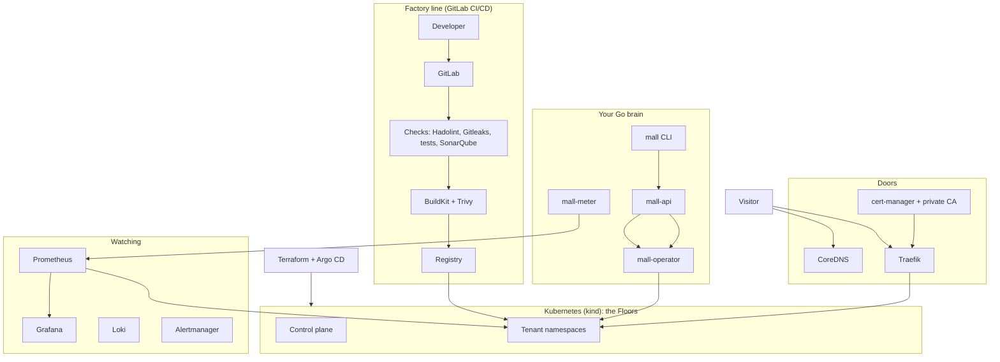

# Mini Cloud, Part 1: a multi-tenant platform on the open-source stack

**Status:** draft for review. The direction (real tools plus your own Go code) was confirmed in conversation on 2026-10-03. This document replaces the earlier "from scratch" spec, which is kept in `archive-from-scratch/`.
**Pictures that go with this document:** `docs/pictures/mini-cloud-stack-design.png` (the design) and `docs/pictures/mini-cloud-stack-map.png` (everything the platform has or could have, 98 items).
**Reading tip:** the "mall" story is kept. Every mall word has a real tool behind it. Technical words are explained the first time they appear.

---

## 1. Purpose

Build a small **multi-tenant platform** by assembling the standard open-source DevOps stack (Docker, Kubernetes, Terraform, GitLab, SonarQube, Prometheus, Grafana and more) and adding an original layer written in **Go**: the part that turns a Kubernetes cluster into a platform that several customers share safely.

Picture a **mall**. The customers are people who make apps. They get locked sections of a shared cluster. They push code to GitLab; a pipeline checks it, scans it and builds it; the platform runs it at `https://<customer>-<app>.mall.hamza` with a padlock, keeps it alive, watches it and sends a monthly bill. You build the mall around the shops, not the shops.

This is **part 1 of 4**. Later parts, only after part 1 works: (2) a security guard (Falco and Wazuh), (3) a file-storage service, (4) a 5G telecom app running on the platform.

**What it is not:**
- Not an online shop and not Shopify. Shopify sells ready-made shops. This platform rents locked sections to programmers.
- Not an attempt to compete with AWS. It is a small, honest model of how a cloud platform works, built with the tools real teams use.
- The closest real example is Heroku. Many companies build the same idea internally and call it an internal developer platform.

**Goals, all four at once:** a flagship project for the job hunt, credibility in the current role, a possible real product later, and deep learning. The stack matches the ESPRIT track *Cybersecurity & Cloud Engineering* (container orchestration, cloud infrastructure, DevSecOps, cloud security).

**Success looks like:**
1. Ahmed pushes code to GitLab. The pipeline passes and his app answers at `https://ahmed-shop.mall.hamza` with the padlock.
2. Every proof in section 11 runs by itself with one command and passes.
3. `terraform destroy` followed by `terraform apply` rebuilds the whole platform from nothing.
4. A demo video shows a good push, a bad push that is stopped, a crash that recovers, a break-in that fails, and a bill.
5. The author can explain every tool in the toolbox and why it was chosen.

---

## 2. Direction and constraints

| Topic | Decision |
|---|---|
| Direction | Real open-source tools, with your own Go layer on top. **Not** from scratch. (Earlier the plan was to write a container runtime and control plane by hand; that was replaced on 2026-10-03.) |
| Language of your own code | Go. It is the language the cloud tools are written in, and Kubernetes operators are written in it. |
| Budget | Zero. No card. Everything runs on the author's own PC, with open-source tools only. |
| Time | About 25 hours a week with **no fixed end date**. Learning the foundations and finishing professionally matter more than speed. The first estimate (16 weeks) assumed the assistant writes the setup files. With you typing everything, expect roughly 6 to 8 months (a guess). |
| Working style | **You type, the assistant teaches.** Small exercises, explanations and reviews. You write all of it: the setup files and the Go code. |
| Starting level | Beginner in cloud. Every step starts with a tiny experiment. |
| Platform | Windows 11 PC with WSL2 and Docker. Kubernetes runs inside Docker through `kind`. |
| Names and padlock | The private, invented ending `.hamza`. Names look like `ahmed-shop.mall.hamza`. CoreDNS answers. cert-manager and a private certificate authority provide HTTPS. |
| Version 1 scope | The 24 CORE and 33 BASIC items on the complete map (57 items). |
| Careful updates (canary) | LATER. It becomes cheap with Argo Rollouts, and the hooks are in place. |

---

## 3. Scope

The complete map (Appendix A) lists everything the platform has or could have. Each item has one status:

| Status | Meaning | Count |
|---|---|---|
| **CORE** | An essential piece of version 1 | 24 |
| **BASIC** | A smaller supporting piece of version 1 | 33 |
| **LATER** | Future work. The design leaves room for it. | 35 |
| **PART 2-4** | A follow-up part: security guard, file storage, 5G app | 3 |
| **SKIP** | Not realistic with zero budget and one PC | 3 |

Billing and payment are different jobs. Counting usage and producing the bill is CORE. Only collecting real money (cards, a payment company) is skipped. The bill shows a total and "paid" is simulated.

### Limits of version 1 (stated openly)
1. **One control plane.** If it dies, running apps keep running, but nothing can change until it is back.
2. **Stateless web apps only.** Apps speak HTTP and forget everything when restarted. File storage is part 3.
3. **Private names and padlock.** Only devices that ask your DNS server and trust your certificate authority see the platform without warnings.
4. **The bill counts CPU, memory and requests.** Not disk or network.
5. **GitLab is self-hosted,** because the free shared runners on GitLab.com ask for a card. Self-hosting costs about 8 GB of RAM.
6. **Everything runs on one PC.** It shows how the platform works. It does not prove real-world scale.
7. **Customers are created by hand** by the admin. There is no sign-up page.

---

## 4. Architecture

### 4.1 Layers



### 4.2 Where each thing runs

| Thing | Where it runs | Why |
|---|---|---|
| Docker | Docker Desktop (or Docker Engine) on WSL2 | The base for kind and for GitLab |
| kind cluster | Docker containers: 1 control plane and 2 workers | Several "Floors" on one PC |
| GitLab CE, GitLab Runner, SonarQube | Docker containers **outside** the cluster, on the same Docker network | Keeps the cluster light and lets the pipeline reach it |
| CoreDNS for `mall.hamza` | A Docker container, plus the in-cluster CoreDNS forwarding `mall.hamza` to it | One name that works from the PC, the nodes and the pipeline |
| Traefik, cert-manager, Calico, metrics-server, Kyverno, Argo CD, monitoring stack | Inside the cluster, installed with Helm | Standard places for them |
| `mall-api`, `mall-operator`, `mall-meter` | Inside the cluster, in a `mall-system` namespace | Your Go code runs like any other app |
| Terraform | On the PC | Builds the cluster, the GitLab and SonarQube containers, the DNS container and the first installs |

### 4.3 The Terraform and Argo CD split
**Terraform bootstraps** (kind cluster, Calico, Argo CD, the private CA files, the GitLab, SonarQube and DNS containers). **Argo CD then installs and keeps in sync** everything else inside the cluster from a Git repository in GitLab: Traefik, cert-manager, the monitoring stack, Kyverno, the operator and the rest. This is a common real-world pattern. The cut list can replace Argo CD with Terraform installing the add-ons directly.

### 4.4 The mall translated into real tools

| Mall word | Real tool |
|---|---|
| Floors (worker nodes) | Kubernetes nodes (kind) |
| Flat and parcel | A container, packed as a Docker image, running in a pod |
| Parcel shelf | GitLab Container Registry |
| Manager | Kubernetes control plane plus your Go operator |
| Notebook | etcd (inside Kubernetes) plus your own small database for usage and bills |
| Counter and `mall` CLI | `mall-api` and the `mall` CLI (Go) |
| Reception desk | Traefik |
| Mall directory | CoreDNS |
| Certificate office | cert-manager with a private certificate authority |
| Meter | Prometheus plus `mall-meter` (Go) |
| Health board | Grafana, Loki, Alertmanager |
| Customers kept separate | Namespaces, quotas, network policies, RBAC |
| Grow and shrink | Horizontal Pod Autoscaler with metrics-server |
| Careful updates (later) | Argo Rollouts |

---

## 5. The Go brain (the part you write)

Four small Go programs. Everything else is configuration of ready-made tools.

### 5.1 `mall-operator`
A Kubernetes **operator**: a program that watches custom objects and makes the cluster match them. Two custom resources (a sketch, not the final shape):

```yaml
apiVersion: mall.hamza/v1
kind: Tenant
metadata: { name: ahmed }
spec:
  quota: { cpu: "2", memory: 2Gi, pods: 10, apps: 3 }
---
apiVersion: mall.hamza/v1
kind: App
metadata: { name: shop, namespace: t-ahmed }
spec:
  image: registry.mall.hamza/ahmed/shop:1.4.0
  port: 8080
  env: { MODE: production }
  health: { path: /healthz }
  scale: { min: 1, max: 5, cpuTarget: 70 }
```

- **For a Tenant** it creates: a namespace (`t-ahmed`), a ResourceQuota, a LimitRange, default-deny NetworkPolicies that allow only Traefik and DNS, RBAC, and the Pod Security "restricted" label.
- **For an App** it creates: a Deployment (non-root, with health probes and resource requests), a Service, the Traefik route for `ahmed-shop.mall.hamza`, and the autoscaler.
- It reports status back on the objects, so `mall list` can show what is happening.

### 5.2 `mall-api`
The front door for customers, at `api.mall.hamza`.
- Authenticates with API tokens (random, shown once, stored hashed).
- Checks that the tenant behind the token may touch the app it asks for.
- Creates or updates the `App` object in that tenant's namespace. It never gives customers raw cluster access.
- Writes an append-only audit log.
- Serves logs (from Loki, filtered to the tenant), usage and the bill.

### 5.3 `mall` CLI
`login`, `deploy`, `list`, `logs`, `delete`, `rollback`, plus admin commands such as `mall admin tenant create sara`. It talks only to `mall-api`, over HTTPS, trusting the private certificate authority through a file (`--ca`).

### 5.4 `mall-meter`
Every minute it asks Prometheus for CPU, memory and request counts per tenant namespace, and stores exact usage in a small database on a persistent volume. Because it keeps its own copy, a Prometheus restart does not lose billing data. A monthly job turns usage and a price list into a bill per tenant.

---

## 6. The factory line (GitLab CI/CD)

Each tenant has a GitLab project that includes one shared **pipeline recipe**:

| Stage | Tool | What stops the pipeline |
|---|---|---|
| Dockerfile check | Hadolint | Mistakes in the Dockerfile |
| Secrets check | Gitleaks | A password or key found in the code |
| Tests | The project's own tests | Any failing test |
| Quality gate | SonarQube Community | A failed quality gate |
| Build | BuildKit | A failed build |
| Image scan | Trivy | Critical security holes in the image |
| Push | GitLab Container Registry | (nothing; this is the delivery step) |
| Deploy | `mall deploy` | A refusal from `mall-api` (token, permission) |

**Pipeline health** (build time, failure rate, quality trends) is shown in Grafana. The exact method (GitLab and SonarQube metrics or their APIs) is decided in milestone 4.

---

## 7. Tenancy and security basics

**Customers kept separate (multi-tenancy):**
- A namespace per tenant, with quota and limit ranges.
- Default-deny network policies, enforced by **Calico** (kind's default network does not enforce them).
- RBAC so a tenant's identity can only touch its own namespace.
- Pod Security "restricted" and **Kyverno** policies: no root, resource limits required, images only from the registry.

**Security basics:**
- Hashed API tokens, per-tenant permissions and an audit log in `mall-api`.
- Pipeline gates: Hadolint, Gitleaks, SonarQube, Trivy.
- HTTPS on every door (section 8). Encryption between pods (a service mesh, mTLS) is LATER.
- Secrets in Vault and single sign-on in Keycloak are LATER. The security guard (Falco and Wazuh) is part 2.

**Honest limit:** containers share one Linux kernel. That is acceptable for a learning platform and is written down openly.

---

## 8. Names and the padlock (DNS and HTTPS)

**The name.** The domain is `mall.hamza`. The ending `.hamza` is invented and private; it does not exist on the public internet and nothing needs to be bought. (A future public ending of the same name is a small, accepted risk.) Apps get `<tenant>-<app>.mall.hamza`. The tools get names too: `gitlab.mall.hamza`, `sonar.mall.hamza`, `grafana.mall.hamza`, `api.mall.hamza`. `mall` is a placeholder. The whole domain is **one setting**.

**The mall directory (CoreDNS).** One wildcard record, `*.mall.hamza`, covers every app, so a new app needs no DNS change. The tools have their own records. ExternalDNS (automatic entries) is LATER because the wildcard makes it unnecessary.

**The certificate office.** No public certificate authority signs an ending that does not exist on the internet, so the platform has its own:
- A script creates a root key and root certificate. The root key stays offline on the author's PC. It is the most sensitive file in the project.
- The root certificate is limited by name constraints to `.hamza` names, so even a leaked one could not forge certificates for real websites. (To verify in milestone 2, because programs differ in how they check this.)
- **cert-manager** uses it as a certificate authority and issues a wildcard certificate for `*.mall.hamza`. Traefik serves it as its default certificate, so no app needs its own.
- The root certificate must be trusted in four places: Windows (browsers), the kind nodes (to pull images), the GitLab Runner's job containers (to push images), and the `mall` CLI (`--ca`).

**The hard part: one name, three viewpoints.** The same name must work from the PC, from inside the cluster and from the pipeline. They see different addresses for the same machine. The planned answer is one DNS server whose answers are reachable from all three, with the cluster's CoreDNS forwarding `mall.hamza` to it. This is the classic pain of local setups, so it is **timeboxed inside milestones 2 and 3**. The fallback is name entries written by hand on the PC and as extra host entries in the cluster.

**Windows and browsers.** Windows is told to ask the platform's DNS server for `.hamza` (a name-resolution rule, administrator rights once). Browsers with "Secure DNS" switched on can bypass it, so it is switched off for the demo. A typed `ahmed-shop.mall.hamza` may need `https://` in front.

**A real domain later.** Buy a domain, point its records at the platform, change the one setting, and use publicly trusted certificates. The design does not change.

---

## 9. Monitoring

Monitoring is different from the Meter. The Meter must be **exact** (it makes the bill). Monitoring must be **fast** (it shows what is wrong now).

- **Prometheus** collects numbers; **kube-state-metrics** and **node-exporter** come with the standard bundle.
- **Grafana** shows dashboards: the cluster, each tenant, the pipeline, and a status page.
- **Loki** keeps the logs of every app. `mall logs` reads them through `mall-api`.
- **Alertmanager** rings on crash loops, a node going down, and error spikes.
- **Traefik metrics** give visits, errors and slowness per app.
- Tracing (OpenTelemetry and Tempo) and OpenCost are LATER.

---

## 10. Billing

- **Usage** per tenant: CPU seconds and memory from Prometheus, requests from Traefik metrics. Stored by `mall-meter` in its own database.
- **Price list:** one list, invented numbers: a price per CPU-hour, per GB-hour of memory and per thousand requests.
- **Bill:** per tenant, per month, with line items and a total.
- **Payment:** simulated. No real money moves.
- **LATER:** a customer view of their own usage, stored past bills, a free allowance, and a cross-check with OpenCost.

---

## 11. Proofs (how we know it works)

No piece is done until its proof runs by itself with one command.

| Piece | The proof |
|---|---|
| Customers kept separate | **Break-in tests:** Sara's pod cannot reach Ahmed's. A pod asking for more than its quota is refused. A pod that runs as root is refused. |
| Factory line | A failing test, a failed quality gate, a leaked password, a bad Dockerfile and a vulnerable image each stop the pipeline. A good push reaches the cluster. |
| Names and padlock | `ahmed-shop.mall.hamza` resolves through your DNS and the browser shows the padlock. The CLI refuses a wrong certificate. |
| Self-healing | Kill a pod and it returns. Stop a worker node and its pods move. |
| Meter and bill | A known load (k6) gives usage numbers that match. Restart the meter and nothing is lost. |
| Autoscaling | A fake crowd makes the copies go up. A quiet period brings them down. |
| Monitoring | A crashing app turns the dashboard red, the logs say why, and an alarm fires. |
| Reproducible | `terraform destroy` and `apply` rebuild the whole platform from nothing. |

The proofs run on every change in GitLab CI (the platform tests itself). Tools: Go tests and scripts, **k6** for the fake crowd, **Chaos Mesh** for breaking things on purpose.

---

## 12. Plan: milestones (about 6 to 8 months), with a checkpoint

There is **no fixed end date**. You type everything and the assistant teaches, so the first estimate of 16 weeks (which assumed the assistant writes the setup files) is replaced by milestones with rough durations at about 25 hours a week. The durations are guesses. Every milestone ends with a demo.

| Milestone | What you do | Demo moment | Rough time |
|---|---|---|---|
| 1. Foundations | Prepare the PC (free disk space, WSL2 memory). Linux and Docker basics. Build one container by hand with Linux commands. Go basics. | A locked room made by hand | 3-4 weeks |
| 2. Cluster, names, padlock | Terraform builds the kind cluster (1 control plane, 2 workers) with Calico, Traefik, cert-manager, CoreDNS for `mall.hamza` and the private CA. A sample app answers at `https://hello.mall.hamza`. | The padlock on your own name | 4-5 weeks |
| 3. Factory line | GitLab CE, Runner and registry. First pipeline: build, push, deploy. Then the SonarQube, Trivy, Gitleaks and Hadolint gates. | Push code and the app updates. A bad push is stopped. | 4-5 weeks |
| 4. Watching and GitOps | Prometheus, Alertmanager, Grafana, Loki, pipeline-health dashboards. Argo CD keeps the add-ons equal to Git. | Kill a pod: red, then green | 3 weeks |
| 5. The Go brain | Operator with Tenant and App, namespaces, quotas, network policies, RBAC, Kyverno rules. `mall-api` and the `mall` CLI with tokens, permissions and audit log. | `mall deploy` works. Sara cannot reach Ahmed. | 6-8 weeks |
| 6. Meter, bill, autoscaling | `mall-meter` and the bill page. Autoscaling with metrics-server and a fake crowd. | Ahmed sees his bill. The crowd makes copies rise. | 3-4 weeks |
| 7. Proofs and polish | Chaos tests. Isolation proofs run in CI. Destroy and rebuild everything. Documentation and the demo video. Careful updates only if you want them. | The platform rebuilt in one command, and the demo video | 3 weeks |
| **Total** | | | **about 26-32 weeks** |

**Checkpoint after milestone 3 (about month 3).** "Push code, the pipeline passes, the app answers at an https name" must work. If it takes much longer than planned, we pause and simplify before going on.

**Because there is no deadline, cutting is your choice, not a necessity.** If you ever want a shorter project, drop in this order:
1. Argo CD (Terraform installs the add-ons directly).
2. Loki (use plain `kubectl logs`).
3. The bill page (Grafana only).
4. Self-hosted GitLab becomes GitLab.com with your own runner. This saves RAM but needs internet. It needs no card if the shared runners are switched off.
5. Autoscaling becomes a manual `mall scale` command.

**No deadline must not become "never finished".** Every milestone has a target date and a monthly review.

---

## 13. Risks

| Risk | Why it matters | What we do |
|---|---|---|
| Tool sprawl | 57 items in version 1. Each tool can fight back. | One golden path. Each tool must earn its place. Cut list. |
| Trusting the private CA and one name for three viewpoints | The classic local-setup pain | Timebox inside milestones 2 and 3, with a hand-written fallback. |
| Your PC | GitLab wants about 8 GB of RAM. The whole stack needs tens of GB of free disk. About 14 GB is free on C: today. | Clean up first, in week 1. Set WSL2 memory limits. |
| Versions and licences move | See section 14 for examples already found | Pin every version and re-check in week 1. |
| Too much for a beginner | Many new tools at once, and you type everything | Tiny experiment before every step. Checkpoint after milestone 3. |
| No deadline | It can turn into "never finished" | Every milestone has a demo and a target date, reviewed monthly. |
| Docker Desktop licence | Free for personal use, education and small companies. A large employer may require a paid licence. | Use Docker Engine inside WSL2 if needed. |

---

## 14. Facts checked on 2026-10-03 (re-check in week 1)

| Fact | Consequence | Source |
|---|---|---|
| SonarQube Community Build analyzes Go, and also Terraform, Kubernetes and Docker files | Free quality gate for the Go code and the infrastructure files | [SonarQube docs](https://docs.sonarsource.com/sonarqube-community-build/analyzing-source-code/languages/go) |
| `kind`'s default network does not enforce network policies | Install Calico | Web search results; confirm in the kind documentation |
| `ingress-nginx` was retired in March 2026 | Use Traefik | [InfoQ](https://www.infoq.com/news/2025/11/kubernetes-ingress-nginx) |
| MinIO community edition is in maintenance mode, archived, with no official images | Part 3 uses SeaweedFS or Garage instead; choice to verify | [It's FOSS](https://itsfoss.com/news/minio-moves-away-from-open-source/) |
| GitLab.com's free shared runners need a card; own runners do not | Self-host GitLab | [GitLab blog](https://about.gitlab.com/blog/prevent-crypto-mining-abuse) |
| GitLab self-managed needs 4 GB RAM minimum, 8 GB recommended | Budget about 8 GB | [GitLab docs](https://archives.docs.gitlab.com/16.3/ee/install/requirements.html) |
| Docker Desktop is free for personal use, education and companies under 250 employees or $10 million revenue | Check the employer; Docker Engine in WSL2 is the alternative | [Docker docs](https://docs.docker.com/subscription/desktop-license/) |
| Terraform changed its licence in 2023; OpenTofu is the community fork | Terraform stays by choice; OpenTofu is a drop-in alternative | Known, to re-check |

---

## 15. Decisions still open

1. **Decided on 2026-10-03:** you type everything and the assistant teaches (small exercises, explanations, reviews).
2. **Where the real project lives:** a permanent folder and a git repository. This session's folder is temporary.
3. **Small technical choices for week 1:** kind or k3d, Calico or Cilium, SQLite or Postgres for usage and bills, Docker Desktop or Docker Engine in WSL2.
4. **Names:** "Mini Cloud", the `mall` command and the second part of the domain (`mall` in `mall.hamza`) are placeholders. The ending `.hamza` is your choice.

---

## Appendix A. The complete map

98 items. Status key: **CORE** = an essential piece of version 1. **BASIC** = a smaller supporting piece of version 1. **LATER** = future work, the design leaves room. **PART 2/3/4** = follow-up parts. **SKIP** = not realistic with zero budget and one PC.

### A. What customers touch (your Go code)

| Mall word | Real tool | Status | Note |
|---|---|---|---|
| Command tool "mall" | mall CLI (Go) | CORE | login, deploy, list, logs, delete, rollback |
| Counter | mall-api (Go) | CORE | tokens, per-tenant permissions, audit log |
| Platform words: Tenant and App | Custom resources (CRDs) | CORE | the platform's own kinds of objects inside Kubernetes |
| Brain that builds tenants and apps | mall-operator (Go) | CORE | namespace, quota, rules, deployment, route, autoscaler |
| Customer accounts | Tenants | BASIC | created by you, by hand. No sign-up page. |
| App settings | Environment variables | BASIC | plain settings inside the App resource |
| Charts page | Bill page + Grafana | BASIC | bill and status: one small Go page plus dashboards |
| Secret settings | Secrets management (Vault) | LATER | encrypted passwords and keys |
| Teams and roles | Roles (RBAC) for customers | LATER | several people per customer |
| Sign-up page and email | Self-service sign-up | LATER | needs email sending and abuse checks |
| Own web address | Custom domains | LATER | needs a real, paid domain |
| Ready-made database | Managed database add-on | LATER | file storage (part 3) comes first |
| Scheduled jobs | CronJobs | LATER | Kubernetes has them; the platform needs a way to ask for one |
| One home page for developers | Developer portal (Backstage) | LATER | a web home for tenants |

### B. The factory line (CI/CD)

| Mall word | Real tool | Status | Note |
|---|---|---|---|
| Code home and pipelines | GitLab CE (self-hosted) | CORE | also holds the registry; wants about 8 GB of RAM |
| Factory worker | GitLab Runner | CORE | runs the pipeline steps |
| Shared pipeline recipe | Pipeline template | CORE | one recipe that every tenant project includes |
| Quality inspector | SonarQube Community | CORE | its quality gate can stop a bad build |
| Recipe checker | Hadolint | BASIC | checks Dockerfiles for mistakes |
| Password finder | Gitleaks | BASIC | finds secrets left inside code |
| Security inspector | Trivy | BASIC | stops builds that have critical security holes |
| Packing machine | BuildKit | BASIC | builds the image |
| Parcel shelf | GitLab Container Registry | BASIC | where images wait; the private certificate must be trusted |
| Caretaker that follows the blueprint | Argo CD (GitOps) | BASIC | keeps add-ons equal to what Git says |
| Pipeline health | GitLab and SonarQube numbers in Grafana | BASIC | build time, failures, quality trends (method to verify) |
| A temporary copy for each change | Review environments | LATER | one per merge request |
| Proof of who built an image | Image signing (cosign) | LATER | signed images |

### C. The cluster (the Floors)

| Mall word | Real tool | Status | Note |
|---|---|---|---|
| Blueprint builder | Terraform (or OpenTofu) | CORE | builds the cluster and tools; destroy and rebuild is a proof |
| Floors on your PC | Kubernetes nodes (kind) | CORE | 1 control plane and 2 workers |
| Locked section per customer | Namespaces, quotas, limit ranges | CORE | the multi-tenancy core |
| Who may do what | RBAC | CORE | per-tenant rights |
| Who may call whom | Network policies | CORE | default deny, allow only the reception desk |
| Delivery boxes | Helm | BASIC | installs ready-made tool bundles |
| Walls and phone lines | Calico | BASIC | kind alone does not enforce network policies |
| House rules | Kyverno policies | BASIC | no root, limits required, images only from the registry |
| Safe pods | Pod Security (restricted) | BASIC | dangerous settings are refused |
| Live gauges | metrics-server | BASIC | needed for autoscaling; kind needs a special flag |
| Grow and shrink | Horizontal Pod Autoscaler | BASIC | copies follow CPU use |
| Self-healing and moving | Kubernetes controllers | BASIC | built in; proven by crash tests |
| Sleep when idle | KEDA (scale to zero) | LATER | wake up on the first visitor |
| Empty a Floor for repair | Node drain | LATER | move its pods away gently first |
| Several control planes | High availability | LATER | removes the single point of failure |
| Backups | Velero | LATER | copy the cluster state somewhere safe |
| Prepare real Linux machines | Ansible | LATER | for real machines instead of kind |
| Many clusters | Multi-cluster | SKIP | one PC, one cluster |
| Heavy hardware | GPU scheduling | SKIP | no such hardware on your PC |

### D. The doors (names, padlock, reception)

| Mall word | Real tool | Status | Note |
|---|---|---|---|
| Reception desk | Traefik | CORE | HTTPS entrance; chosen because ingress-nginx was retired in March 2026 |
| Mall directory | CoreDNS (zone for mall.hamza) | CORE | one wildcard name covers every app |
| Certificate office | cert-manager + private CA | CORE | makes the wildcard certificate |
| Names like ahmed-shop.mall.hamza | DNS names | BASIC | a private, invented ending; the domain is one setting |
| Padlock | HTTPS on every door | BASIC | your PC and the nodes must trust the private CA once |
| Names that work from everywhere | Split DNS: PC, nodes, pipeline | BASIC | the same name must work from all three; a known pain |
| Names for the tools too | gitlab, sonar, grafana under mall.hamza | BASIC | the tools get names and padlocks as well |
| Spreading visitors | Load balancing (Traefik + Services) | BASIC | built in |
| Automatic DNS entries | ExternalDNS | LATER | not needed while one wildcard name exists |
| Certificates renewed by themselves | Short-lived certificates | LATER | in v1 the certificate lasts long |
| Limit visitors per second | Rate limiting (Traefik) | LATER | protects apps from floods |
| Encryption between pods | Service mesh (Linkerd or Istio) | LATER | parts prove who they are |
| Limit outgoing calls | Egress policy | LATER | pods cannot call the internet freely |
| A real internet domain | Public domain and public certificates | LATER | costs money; only settings change |

### E. Watching (monitoring)

| Mall word | Real tool | Status | Note |
|---|---|---|---|
| Meter reader | Prometheus | CORE | collects numbers over time |
| Charts | Grafana | CORE | dashboards and the status page |
| Complaints book | Loki (logs) | BASIC | what each app printed |
| Alarm bells | Alertmanager + alert rules | BASIC | crash loops, node down, error spikes |
| Cluster gauges | kube-state-metrics, node-exporter | BASIC | come with the Prometheus bundle |
| Visitor counts | Traefik metrics | BASIC | visits, errors and slowness per app |
| Platform health | Platform dashboards | BASIC | nodes, control plane and tools |
| Following one visit | Tracing (OpenTelemetry, Tempo) | LATER | find where a slow visit lost time |
| Cost cross-check | OpenCost | LATER | compare with your own meter |

### F. Billing (your Go code)

| Mall word | Real tool | Status | Note |
|---|---|---|---|
| Meter | mall-meter (Go) | CORE | reads Prometheus and stores exact usage |
| Bill | Usage report per month | CORE | one per tenant |
| Price list | Pricing plan | BASIC | one simple price list |
| Customer sees own usage | Usage view per tenant | LATER | "mall usage" and a page |
| Past bills kept | Invoice history | LATER | one stored bill per customer per month |
| Free allowance | Free tier | LATER | some usage free each month |
| Collecting real money | Payments (cards) | SKIP | needs a payment company and a card; simulated instead |

### G. Security

| Mall word | Real tool | Status | Note |
|---|---|---|---|
| Break-in tests | Isolation tests | CORE | Sara cannot reach Ahmed, quotas hold, root is refused |
| ID check and permissions | Hashed API tokens, per-tenant permissions | BASIC | inside mall-api |
| Logbook of who did what | Audit log | BASIC | every action is recorded |
| Secrets vault | Vault | LATER | real secret storage |
| One login for everything | Keycloak (single sign-on) | LATER | one identity for all tools |
| Parts prove who they are | mTLS (service mesh) | LATER | encrypted, identified traffic between pods |
| Signed images and strict checks | cosign + Kyverno verification | LATER | only signed images may run |
| Guard watching for attacks | Falco + Wazuh (SOC) | PART 2 | the security-guard part |

### H. Storage and data

| Mall word | Real tool | Status | Note |
|---|---|---|---|
| Files that survive a restart | Persistent volumes | LATER | in v1 apps forget everything |
| File storage service | Object store (SeaweedFS or Garage) | PART 3 | MinIO community edition is retired; choice to verify |
| Databases | Managed databases | LATER | after storage works |
| Backups for customers | Customer backups | LATER | needs storage first |

### I. Building and testing the platform itself

| Mall word | Real tool | Status | Note |
|---|---|---|---|
| Proofs | Automated tests (Go tests, scripts) | CORE | one command runs them all |
| One-command rebuild | terraform apply and destroy | CORE | rebuild the whole platform from nothing |
| Docs and demo video | Documentation | CORE | your portfolio |
| Proofs run on every change | GitLab CI for the platform repo | BASIC | the platform tests itself |
| Fake crowd | k6 load tests | BASIC | drives the autoscaling proof and the meter proof |
| Break things on purpose | Chaos Mesh | BASIC | kill pods and nodes |
| Careful updates | Argo Rollouts (canary) | LATER | cheap with these tools; the hooks are in place |

### J. Extra parts and ideas

| Mall word | Real tool | Status | Note |
|---|---|---|---|
| Telecom 5G app on the platform | Open5GS on Kubernetes | PART 4 | a showcase app |
| Many platforms joined together | Federation | LATER | place apps by cost, delay or carbon |
| Tiny on-demand functions | Serverless (Knative) | LATER | code that runs only when called |

